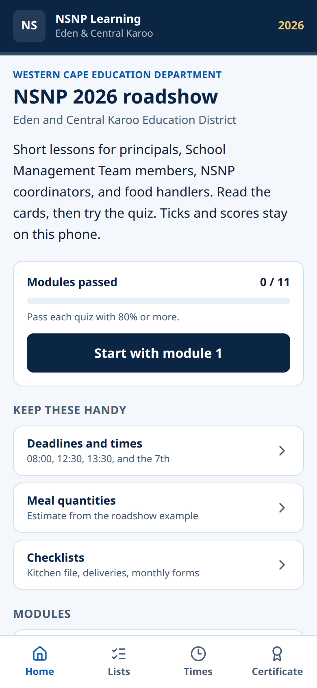
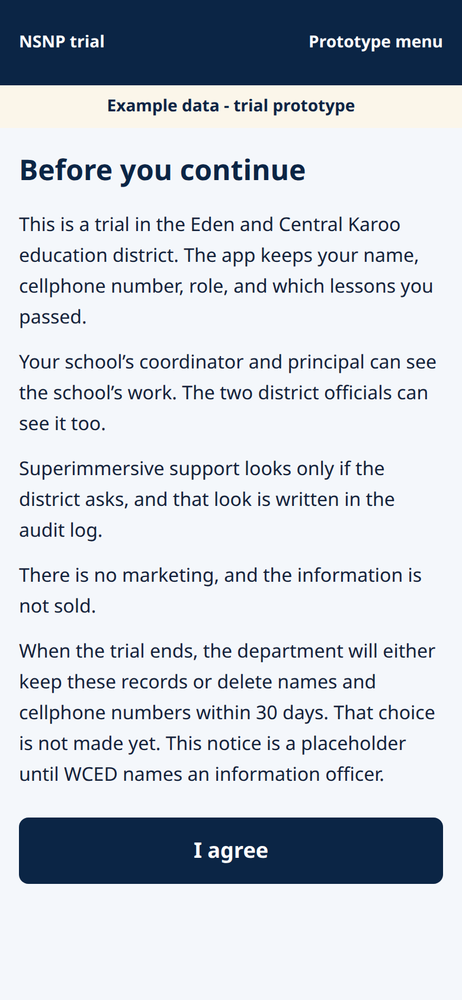
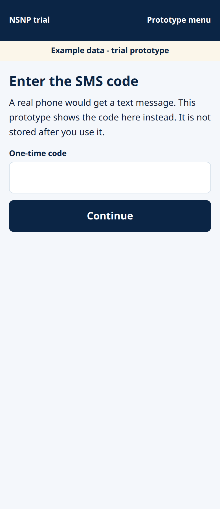
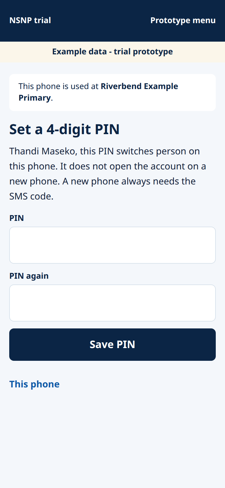
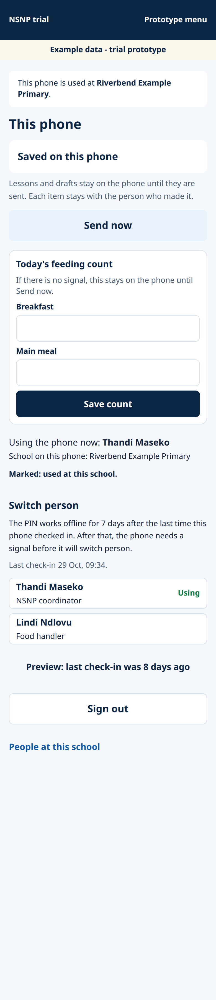
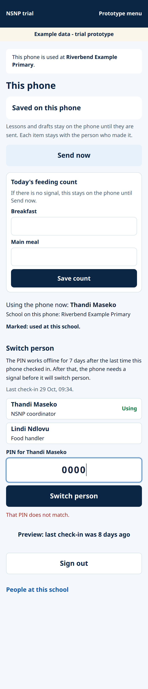
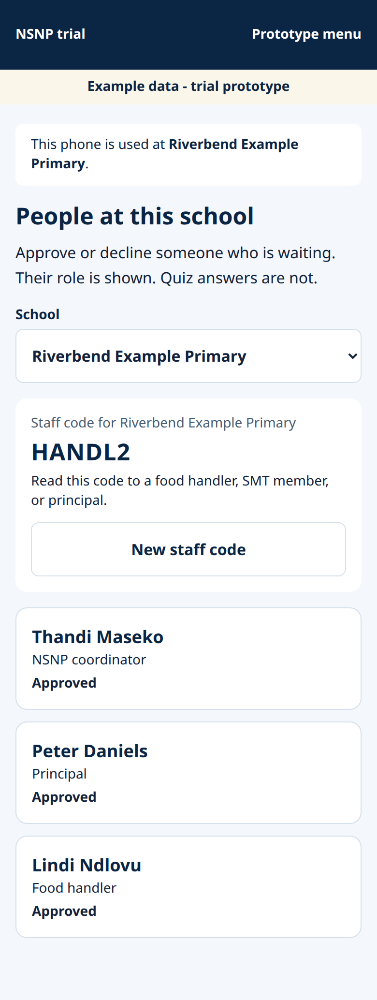
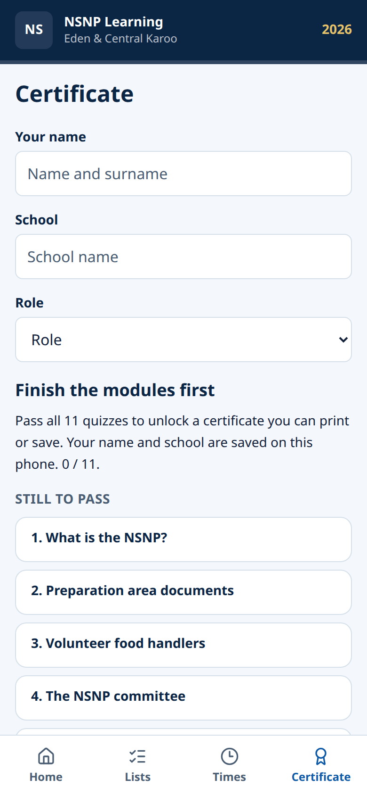

# School coordinator guide

Eden and Central Karoo trial. October 2026.

This guide is for the NSNP coordinator at a trial school. You join with a code from your district official, then you send the daily feeding count and approve other staff.

Lessons and quizzes work with no login. Ticks and scores stay on the phone until you join.

The pictures were taken on a practice copy. They show example schools, such as Riverbend Example Primary, and a yellow line that says **Example data - trial prototype**. On the live site your own school name is shown. Do not type the codes from the pictures. The examples in the steps are **ABC123** and **082 000 0000**.

## 1. Open the web app

1. On the school phone, open Chrome.
2. Go to **https://superimmersive.io/nsnp-learning-app/**
3. You should see **NSNP 2026 roadshow** and **Start with module 1**.

You can read lessons and try quizzes now. Nothing is sent to the district until you join and tap **Send now**.

The bottom bar is **Home**, **Lists**, **Times**, and **Certificate**. **Help** is in the top bar.

## 2. Join with your code and cellphone

Your district official gives you a join code and writes down your cellphone. The code works only with that number. It lasts 14 days and can be used once.

1. Open **https://superimmersive.io/nsnp-learning-app/join**
2. Leave **Coordinator code** selected. **Staff code** is for other people at the school.
3. **School code:** type the code, for example ABC123.
4. Type your first name and surname.
5. **Cellphone:** type the number the official recorded, for example 082 000 0000.
6. Tap **Continue**.

If the number does not match, the screen says the code only works with the cellphone the official recorded. Phone the official. Do not try another person's number.

## 3. Agree to the trial notice

Read the notice. It says the trial keeps your name, cellphone, role, and which lessons you passed. Your coordinator, principal, and the two district officials can see the school's work.

Tap **I agree**.

## 4. Enter the SMS code

A text message is sent to the cellphone you typed. It is a 6-digit code.

1. Open the message.
2. Type the 6-digit code sent by SMS into **One-time code**.
3. Tap **Continue**.

The code lasts about 10 minutes. If it expires, go back and start the join again so a new message is sent.

The practice copy may show a code on the screen. On the live site, use only the code in the text message.

## 5. Set a PIN

The PIN switches person on this phone. It does not sign you in on a new phone. A new phone always needs the SMS code.

1. Type 4 digits.
2. Type the same 4 digits again.
3. Tap **Save PIN**.

The app will not accept four of the same digit, such as 1111. It will not accept 1234 or 4321.

## 6. Use the PIN on a shared phone

The kitchen phone can hold more than one person. Open **This phone** at **https://superimmersive.io/nsnp-learning-app/join/phone**

- The line **Using the phone now** shows who is active.
- Tap another person's name.
- Type their PIN and tap **Switch person**.

The PIN works offline for 7 days after the last time this phone checked in. After that, the phone needs a signal before it will switch person.

## 7. Too many wrong PINs

A wrong PIN shows **That PIN does not match.**

The app does not lock the phone after several wrong tries. You can try again. There is no waiting time and no blocked account.

If you cannot remember the PIN:

- Tap **Sign out** on **This phone**.
- On a phone that has signal, open **New phone? Sign in with your cellphone** and use the SMS code again.
- Set a new PIN.

The PIN from the old phone does not move to a new phone.

## 8. Log the daily feeding count

Do this on a school day, before 13:30. On time means the phone recorded the count before 13:30 South African time.

1. Open **This phone**.
2. Under **Today's feeding count**, type how many learners had breakfast and how many had the main meal.
3. Tap **Save count**.
4. If the phone has no signal, the count stays on the phone. The screen says **Saved on this phone**.
5. When there is signal, tap **Send now**.

## 9. Edit or correct a count

This screen has no Edit button.

- If you have not tapped **Send now**, the count is still only on the phone. Do not send a second count for the same day. Phone your district official before you send it.
- If you already sent it, you cannot change that number on this screen. Phone your district official. Tell them the right breakfast number, the right main-meal number, and the reason. The first number is kept. A correction is a new record with that reason. The old number is not deleted.

## 10. Add staff with a staff code

The app does support staff codes.

1. On **This phone**, tap **People at this school**.
2. Read the **Staff code** on the screen to the food handler, SMT member, or principal. The picture shows an example school. Read the code on your own screen, not the code in the picture.
3. They open **https://superimmersive.io/nsnp-learning-app/join** and tap **Staff code**.
4. They type the staff code, their name, their cellphone, and their role, then agree to the notice and enter the SMS code.
5. They wait. You return to **People at this school** and tap **Approve**. **Decline** removes them.

A staff code can be used by more than one person until you tap **New staff code**. Quiz answers are not shown on this page.

## 11. Certificate

The certificate is a learning record. It is not an official WCED certificate.

1. Tap **Certificate** in the bottom bar.
2. Pass all 11 quizzes. The pass mark is 80%, which is 4 out of 5.
3. When the page says the certificate is ready, type your name and school if they are empty, then print or save it.

Until then the page says **Finish the modules first** and lists what is still to pass. The name and scores stay on this phone.

## 12. Sign out

On **This phone**, tap **Sign out**.

That clears who is using the phone now. Lessons already stored on the phone stay on the phone. It does not delete the district's copy of a count you already sent.

To use the phone as someone else, tap their name and enter their PIN.

## If something goes wrong

- **The code is not on the trial list.** Check the letters with your official. Ask for a new code if it was withdrawn.
- **The code has expired.** A coordinator code lasts 14 days. Ask the official for a new one.
- **The code has already been used.** A coordinator code works once. Ask for a new code.
- **Wrong cellphone.** Use the number the official wrote down.
- **The SMS code does not match.** Wait for the newest message. The code lasts about 10 minutes.
- **That PIN does not match.** Try again. If you are stuck, sign in again with the SMS code and set a new PIN.
- **This phone needs a signal.** The phone has not checked in for 7 days. Connect, then switch person.
- **The count is still Saved on this phone.** Move to signal and tap **Send now**.
- **The website will not open.** Try Chrome. Check the address **superimmersive.io/nsnp-learning-app**. Then tell Superimmersive.

## FAQ

**Can I do the lessons before I have a code?**  
Yes. Open the home page and start module 1. Scores stay on the phone.

**Do I need the Play Store app?**  
No. The trial runs in the phone browser at the address above.

**Who sees my quiz answers?**  
Your coordinator and principal can see that you passed. The answer you picked is not shown to the district official.

**Who do I phone?**  
Your Eden and Central Karoo district official, for codes, counts, and staff. Superimmersive, if the website itself will not load.
