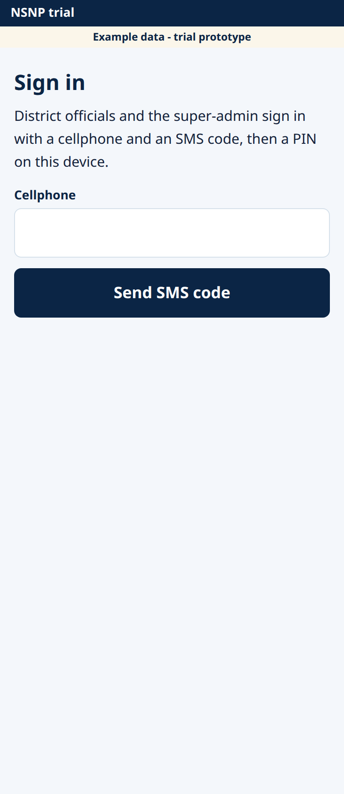
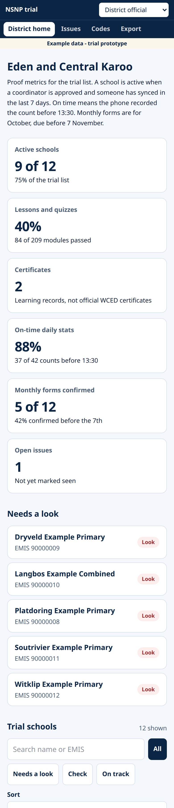
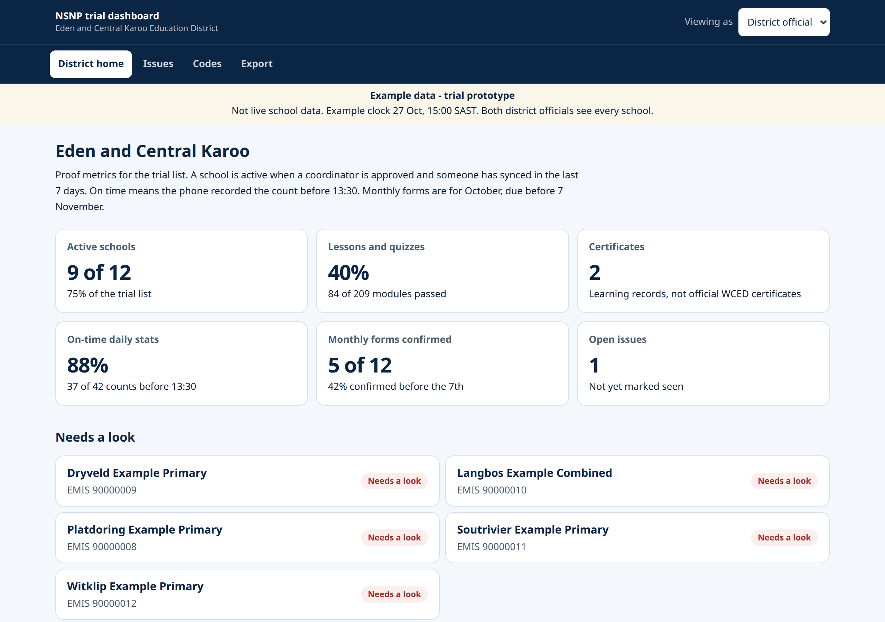
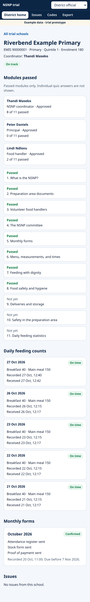
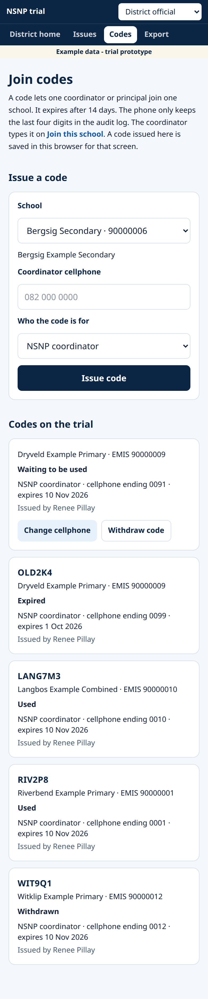

# District official guide

Eden and Central Karoo trial. October 2026.

This guide is for the two district officials. You both see every trial school. You sign in, read the dashboard, open a school, and give each coordinator a join code.

The pictures were taken on a practice copy. They show example schools and a yellow line that says **Example data - trial prototype**. On the live site that line is not the way you tell schools apart. Use the school name and the EMIS number. The example cellphone in these steps is **082 000 0000**. The example join code is **ABC123**. Yours will be different.

## 1. Sign in

1. On your phone or computer, open Chrome.
2. Go to **https://superimmersive.io/nsnp-learning-app/officials**
3. Type the cellphone the trial has for you.
4. Tap **Send SMS code**.
5. Type the 6-digit code sent by SMS.
6. Choose a 4-digit PIN and type it twice. Not 1111, and not 1234 or 4321. Tap **Save PIN**.

The PIN stays on this device. A new phone or a new browser needs the SMS code again.

The dashboard menu stays hidden until this sign-in is finished, and only if your role is district official.

## 2. Read the dashboard

After you sign in, the top of the page says **Eden and Central Karoo**. The menu is **District home**, **Issues**, **Codes**, and **Export**.

Six cards sit under the heading.

- **Active schools.** A school is active when a coordinator is approved and someone has synced in the last 7 days.
- **Lessons and quizzes.** The share of modules passed on the trial list.
- **Certificates.** Learning records after all 11 quizzes. They are not official WCED certificates.
- **On-time daily stats.** The phone recorded the count before 13:30.
- **Monthly forms confirmed.** October forms are due before 7 November. The month is written as a word, for example October 2026.
- **Open issues.** Reports not yet marked seen. Tap the card to open the list.

On a computer the same cards sit in a grid, and the school list is a table.

## 3. Chips and colours

Each school has a short chip.

- **Needs a look**, shown as **Look** on a phone. Red. There is no approved coordinator, an open issue, a missing count, or a late monthly form.
- **Check**. Amber. The count was late, the phone clock needs a check, the monthly form is not in yet, an issue was seen but not closed, or the school has not synced recently.
- **On track**. Green. None of those problems.

Under **Needs a look**, open any red school first.

**Trial schools** lets you filter with **All**, **Needs a look**, **Check**, and **On track**.

## 4. Find a school

On **District home**, use **Search name or EMIS**.

Type part of the school name, or the EMIS number. Example schools in the practice copy use numbers from 90000001. A real trial school uses its own EMIS number.

Tap the school name. The school page shows people, daily counts, monthly forms, and issues for that school only.

## 5. Understand the counts

On the school page, **Daily feeding counts** is the list the coordinator sent.

- **On time** means the phone recorded the count before 13:30 on that feeding day, and the phone clock was close to the server clock.
- **Late** means the phone time was 13:30 or after. 13:30 itself is late.
- **No count** means nothing has arrived for that day.
- **Check the time**, shown as **Time** on a phone, means the phone clock did not match the server. Use the server time for that row.

A count is not edited in place. If a coordinator sends a correction, the new row is the one that counts, and the old row is kept with the reason.

**Monthly forms** for October should be confirmed before 7 November. The chip says **Confirmed before the 7th**, **Not confirmed yet**, or **Late**.

## 6. Generate a join code

Do this before the coordinator tries to join.

1. Tap **Codes**.
2. Choose the school.
3. Type the coordinator's cellphone, for example 082 000 0000. The code works only with this number.
4. Leave **Who the code is for** as **NSNP coordinator**, unless you are coding a principal.
5. Tap **Issue code**.
6. Read the new code to the coordinator, or send it to them yourself. In this guide we call an example code ABC123. The screen shows the real code.
7. Tell them the address **https://superimmersive.io/nsnp-learning-app/join** and to choose **Coordinator code**.

The code expires after 14 days. It can be used once. If you typed the wrong number and the code is not used yet, tap **Change cellphone**. If the coordinator should not use it, tap **Withdraw code**.

## 7. Who to contact

- A school that cannot join, or a count that looks wrong: phone the other Eden and Central Karoo NSNP official, then the school coordinator.
- The website will not open, or sign-in never sends a text message: tell Superimmersive, the team that built the trial.
- Do not send a list of real cellphone numbers by email unless the department has agreed.

## FAQ

**I typed the wrong PIN.**  
The screen says **That PIN does not match.** Try again. You are not locked out. If you cannot remember it, sign out and start again with the SMS code.

**The menu is missing.**  
You are not signed in, or this cellphone is not a district official. School staff use the lesson home, not this dashboard.

**Both officials see the same schools.**  
Yes. That is the trial setup. You do not split the list.

**The yellow example banner.**  
The practice copy shows **Example data - trial prototype**. Use the live address above for real schools.

**A code failed at the school.**  
Check that it is not expired, withdrawn, or already used, and that the coordinator typed the cellphone you recorded.
