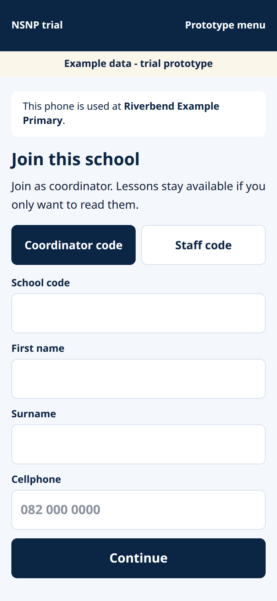

# Coordinator quick start

One page. The full steps are in the coordinator guide.

Open **https://superimmersive.io/nsnp-learning-app/** in Chrome on the school phone. You can read lessons with no login. Scores stay on that phone until you join.

1. Ask your district official for a join code and use the cellphone they wrote down. In these guides the example code is **ABC123** and the example number is **082 000 0000**. Yours will be different.
2. Tap **Coordinator code**. Type the code, your name, and that cellphone. Tap **Continue**.
3. Read the notice and tap **I agree**.
4. Type the 6-digit code sent by SMS. Tap **Continue**.
5. Choose a 4-digit PIN and type it twice. Not 1111, and not 1234 or 4321.
6. Open **This phone**. Under **Today's feeding count**, type breakfast and the main meal, then **Save count**. When the phone has signal, tap **Send now**. Do this before 13:30.
7. To add a food handler, SMT member, or principal, open **People at this school** and read them the staff code on that screen.

If the PIN is wrong, the screen says **That PIN does not match.** You can try again. The app does not lock you out. A new phone always needs the SMS code again.

Help: your Eden and Central Karoo district official. If the website will not open at all, tell Superimmersive.

