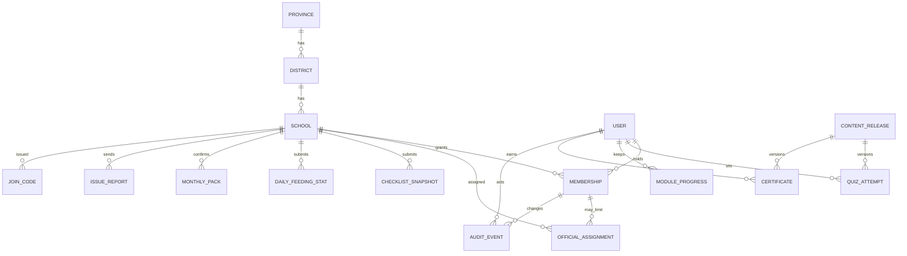

# User and data plan — NSNP Learning

**Status:** draft for discussion. October 2026.
**Audience:** the two Eden and Central Karoo district officials running the trial, WCED NSNP colleagues, and Superimmersive.
**This document only.** It does not change the app, the website, or the store builds. It is a plan, not legal advice and not a quote.

The National School Nutrition Programme (NSNP) learning app turns the 2026 roadshow into 11 short lessons. Today every score stays on the phone, so the district sees nothing.

The first release is an **in-field proof of concept**, not a province-wide system. WCED treats Eden and Central Karoo as **one** education district. The trial is that district, the schools on the agreed list inside it, two district officials, and a Superimmersive admin. Province-wide roles and extra districts come later. The database is shaped so that later step is new rows, not a rebuild.

## How to read this

1. The trial plan says who is in the first release, what the two officials look at, and what happens to the data when the trial ends.
2. Sections 1 and 2 describe roles and the initial database. The trial tables are marked. Columns that exist only so a later district can be added are marked too.
3. Sections 3 and 4 describe sign-in without email, and offline use.
4. Sections 5 and 6 describe the trial dashboard and privacy, including the keep-or-wipe choice.
5. Sections 7 and 8 compare hosts and the order of work. Cost figures in section 7 are estimates, not a tender price.
6. Section 9 lists decisions still open, including the school list, whether the two officials split schools, and the trial dates.

A short version of the recommendation:

Run the trial in Eden and Central Karoo only. District officials hand each school a join code. The coordinator approves the rest of the staff. Store accounts, quiz progress, certificates, daily counts, monthly-form confirmations, and issue reports in PostgreSQL with row-level security, in a South African data centre (Azure South Africa North is the preferred host). Give both officials the same view of every trial school unless the district chooses to split the list. Keep province admin and further districts as a later phase. Ship the first Play Store and App Store build as the lesson app without accounts. The trial itself can run from the website.

---

## Trial plan

### Who is in the trial

| Seat | How many | What they do in the trial |
| --- | --- | --- |
| District official | Two accounts | See every school on the trial list, issue join codes, watch the proof metrics, close issue reports. |
| School NSNP coordinator | One active person per trial school | Claims the school with the join code. Approves principal, SMT members, and food handlers. |
| Principal, SMT member, food handler | The people the coordinator approves | Lessons, quizzes, checklists. Food handlers can draft the daily count. The coordinator or principal submits it and confirms the monthly forms. |
| Superimmersive admin | One operator account | Publishes the content release, unblocks a stuck join, reads the audit log. Does not edit a feeding count. |

No province admin account is created for the trial. No second district is loaded. Learners and RCL members do not get accounts.

Working assumption, until the district says otherwise: **both officials see all trial schools.** The screen is the same for both. A split (each official sees only some schools) is an open question. The database can do either without a migration. See seed data below.

### How a school joins

1. Before the trial opens, load the district and the school list from the EMIS CSV (seed data, below). Schools that are not on that list cannot join.
2. A district official records the coordinator’s name and cellphone on a school and issues a join code. The code expires after 14 days. The official reads it out on a visit or a phone call. The app does not send the code.
3. The coordinator enters the code, their name, and that same cellphone, then the SMS one-time code. The code does nothing on any other number.
4. The coordinator approves other staff. Those people enter a staff code for the same school, confirm their own cellphone by SMS, and wait on a “pending” screen until the coordinator (or the principal, once approved) accepts the role. Lessons stay available while they wait. Nothing they do becomes a school submission until they are approved.
5. Either official can withdraw a code, decline a pending person, or replace a coordinator who has left. That action is in the audit log.

A person who only wants to read a lesson still needs no account. An account is how the trial becomes visible to the two officials.

### What the two officials see

One district home, shared by both accounts while the school split is empty.

- **Trial list** — every seeded school, EMIS number, name, and whether a coordinator is approved.
- **Active schools** — a school counts as active once a coordinator is approved and someone has synced in the period the dashboard is showing (default: the last 7 days).
- **Lessons and quizzes** — modules passed per school, and whether the coordinator has passed each one. Failed tries stay out of this view. The official does not see which option a named person picked.
- **Certificates** — how many learning records have been issued. The page keeps today’s wording: it is a learning record, not an official WCED certificate, unless WCED changes that.
- **On-time daily stats** — for each recent feeding day, which schools submitted a count of learners fed, the phone time, and the server time. “On time” means the phone time is before 13:30 Africa/Johannesburg and the phone clock was plausible. Both times are visible. The rule is in section 4.
- **Monthly forms** — for the feeding month in view, which schools have confirmed that the attendance register, the stock form, and the proof of payment were sent, and whether that confirmation was before the 7th of the next month.
- **Issues** — open reports from schools (delivery, safety, forms, the app itself, or other), and who has marked them seen or closed.

Tapping a school opens EMIS number, coordinator name, module progress, the latest counts, the monthly confirmation, and that school’s issues. A CSV of the same rows is enough for the trial. A one-page PDF can wait.

The home screen lists schools that need a look: nobody joined, no count yesterday, monthly pack not confirmed as the 7th approaches, an issue still open. It does not send SMS alerts during the trial. The two officials open the dashboard.

### Metrics that prove the concept

These are the numbers the trial exists to produce. Each one is on the dashboard above.

| Metric | What “we can see it” means |
| --- | --- |
| Active schools | Share of the seeded list with an approved coordinator and a sync in the last 7 days. |
| Lesson and quiz completion | Modules passed, by school and by role, from the 11 roadshow quizzes (pass mark 80%, 4 out of 5). |
| Certificates | Count of people who have passed all 11, with school and role. |
| On-time stats | Daily feeding counts with a clear on-time or late mark against 13:30. |
| Monthly forms | Confirmations of the three forms, with a clear mark against the 7th. |
| Issues reported | Count opened, seen, and closed, by kind. |

The daily count is the number of learners fed, not a copy of the stock spreadsheet. The monthly confirmation records that the three forms were sent. It does not upload identity documents or signed payment proofs.

### Trial length and success criteria

**Suggestions for the district to edit. Not agreed dates, and not a target the builder can sign.**

Length: **six weeks**, placed so the window includes real feeding days and **one 7th of the month**. A trial that ends before a 7th can prove lessons, quizzes, and daily stats, and cannot prove the monthly-forms metric. Dates themselves are an open question (section 9).

Suggested success criteria at the end of that window:

1. **Coverage.** At least 70% of schools on the agreed list have an approved coordinator within the first two weeks.
2. **Learning.** Among those schools, at least half have someone who has passed six or more modules, and the dashboard shows at least one certificate.
3. **Daily stats.** On five feeding days in the window, most active schools have a count, and each count is marked on time or late.
4. **Monthly forms.** The window includes a 7th, and the dashboard shows which active schools confirmed the three forms before that date.
5. **Issues.** Every issue filed in the trial is marked seen within three school days, by one of the two officials or by the Superimmersive admin.
6. **The officials can use it.** At the weekly check, both officials open the dashboard themselves and talk about a school from it.
7. **Privacy.** No personal-information incident during the run. A school that leaves can have its staff names and numbers removed.

Misses are findings, not automatic failure. A school with no signal for a week tells the district something about the offline queue. The point of the trial is to learn that while the list is still one district.

### Support and feedback during the run

- **School NSNP questions** (a form, a delivery, a rule) go to the two officials, as an issue report or by the phone numbers the district already uses.
- **The app will not send, or a code fails** goes to Superimmersive as an issue of kind `app`, and to the two officials so they know the school is stuck.
- **Suggested rhythm:** a 30-minute check once a week for the six weeks. Same dashboard, a short list of issues opened and closed, and one decision written down (for example “join codes for the remaining schools go out on Thursday”).
- Lesson wording does not change mid-trial unless a fact is wrong (a rand amount, a safety step). That change is a new content release, and old quiz passes stay passes. A fix that unblocks sync can ship during the trial.
- The two officials and one named Superimmersive contact are the only support path. There is no public hotline in the app.

### After the trial: keep or wipe

This choice is recorded **before the first join code is issued**, and the sign-in notice tells staff which one it is. Both options are POPIA choices about personal information (names, cellphone numbers, roles, quiz answers tied to a person, issue text). Head counts that cannot identify a learner are a smaller question, and the suggestion below still treats them as part of the trial record.

**Suggestion A — the trial becomes normal use in this district.** Keep the rows. The retention table in section 6 applies from the trial start date. Tell every school that on the consent screen. Adding another district later does not require deleting this data.

**Suggestion B — the trial stops.** Within 30 days of the end date:

1. Freeze new sign-ins.
2. If WCED wants a lessons-learned note, export school-level totals only: EMIS number, modules passed, certificate count, on-time rate, monthly-form mark, issue counts. No names, no cellphone numbers, no quiz answers.
3. Delete staff names, cellphone numbers, join codes, quiz answers, certificates tied to a person, and issue text.
4. Delete trial backups in the same region on the same clock.
5. Write to WCED that the deletion is done. Superimmersive does not keep a private copy.

A person who asks for their record during the trial gets it through their coordinator or the two officials. The information-officer contact is the one WCED names before go-live (section 6).

### Seed data

The initial database is loaded with the trial, and with nothing else.

**Province row (one).** Present so a later province admin has a scope to attach to. Name: Western Cape Education Department. No user points at it in the trial.

**District row (one).** Name: Eden and Central Karoo Education District. `province_id` set. This is the district the two officials are members of. WCED treats Eden and Central Karoo as one district, so the seed is one row, not two.

**Schools, from an EMIS CSV.** One row per school on the trial list. The file is supplied by the department. Suggested columns:

| Column | Required | Notes |
| --- | --- | --- |
| `school_number` | Yes | EMIS number, kept as text so leading zeros survive. Unique. |
| `name` | Yes | Official school name. |
| `phase` | No | Primary, secondary, combined, or special, when the extract has it. |
| `quintile` | No | When the extract has it. |
| `enrolment` | No | Used only as a soft check against the daily count. |

Every row is loaded under the one district. The importer does not trust a district column on the first file. If a later file includes a district code, rows that are not Eden and Central Karoo are rejected until the later phase is switched on. Schools missing from the file cannot be joined. A school on the file with nobody joined still appears on the dashboard, which is how coverage is measured.

**Two district officials.** Created before any school code is issued. For each person the district names: first name, surname, cellphone, role `district_official`, `district_id` pointing at Eden and Central Karoo. No school assignment rows. Empty assignment means both see every trial school. If the district chooses a split before go-live, the seed adds assignment rows and each official then sees only those schools. Names are not invented here. The roadshow presenters are not assumed to be these two accounts.

**Superimmersive admin.** One user, role `super_admin`, scope `platform`. Recorded in the audit log whenever they open a school.

**Content release.** One row, locale `en`, hash of `app/src/data/content.en.json`, so quiz attempts in the trial point at the lessons schools actually used.

Nothing else is seeded. No sample learners, no sample counts, no second district.

---

## 1. Users and roles

### Who the app is for

A person holds a **membership**: a role at a scope. In the trial the scopes in use are one school, the one district, or the platform. The province scope exists on the membership row so a later WCED admin is an insert, not a migration.

### Trial roles

| Role | Scope | What they do in the trial |
| --- | --- | --- |
| Food handler | One school | Learn the lessons, tick the kitchen checks, and draft the count of learners fed. |
| SMT member | One school | Learn the lessons, and see whether the school’s pack is ready before it is submitted. |
| School NSNP coordinator | One school | Claim the school. Approve staff. Submit the daily count and the monthly confirmation. The principal appoints this person. An SMT member is the recommended choice in the lesson. |
| Principal | One school | Accounting officer. See the whole school. Approve staff if the coordinator is not available. |
| District official | Eden and Central Karoo | Two accounts. See all trial schools (or the subset assigned to them, if the district splits the list). Issue join codes. |
| Superimmersive super-admin | Platform | Publish a content release, look at the audit log, and unblock a stuck account. Support access is recorded. This role does not quietly change a feeding count. |

### Later roles (not seeded, not shown in the trial)

| Role | Scope | When it appears |
| --- | --- | --- |
| Province / WCED admin | Western Cape | When a second district is added, or when WCED asks for a view across districts. They see every district that is switched on, and which quiz questions are missed, with no names. |
| District official in another district | That district | A new district row, its schools, and its officials. Eden and Central Karoo schools stay invisible to them. |

The role check allows `province_admin` from day one. The trial creates no such user. Screens for a province switcher are built in the later phase (section 8).

The lessons also name two committee seats that are **not** logins in this plan:

- A governing-body member is an adult who sits on the NSNP committee. Whether they need an account is an open question (section 9). They do not need one for the trial.
- A Representative Council of Learners (RCL) member is a learner at a secondary school. This app does not create accounts for learners. Learner names, class lists, and identity numbers are out of scope.

One login can hold more than one membership over time (a coordinator who moves school). In the trial each person has one. The usual case stays one membership.

### What each role can do

“Own” means that person’s lessons and certificate. “School” means that EMIS school. “Trial district” means every school on the seeded list, or the official’s assigned subset if the list is split. The province admin column is the later phase. Those cells are not built as screens for the trial.

| | Food handler | SMT member | Coordinator | Principal | District official (trial) | Province admin (later) | Super-admin |
| --- | --- | --- | --- | --- | --- | --- | --- |
| Open lessons, quizzes, checklists, deadlines, meal estimate, honorarium lookup | Yes | Yes | Yes | Yes | Yes, to see what schools see | Yes | Yes |
| Save their own quiz progress and certificate | Yes | Yes | Yes | Yes | No personal certificate required | No | No |
| Tick checklists on the phone | Yes | Yes | Yes | Yes | No | No | No |
| Submit a checklist snapshot the officials can see | | | Yes | Yes | | | |
| Enter the daily feeding count | Yes, draft | | Yes, submit | Yes, submit | | | |
| Confirm the three monthly forms were sent | | See the draft | Yes | Yes | | | |
| Report an issue | Yes | Yes | Yes | Yes | Close it | Close it | Close an app issue, logged |
| Approve or remove staff at the school | | | Yes | Yes | Yes, override | Yes, override | Yes, override, logged |
| See one school’s progress and submissions | Own work only | Yes | Yes | Yes | Yes, for schools in scope | Yes | Yes, logged |
| See the trial roll-up | | | | | Yes | Yes | Yes |
| See all districts | | | | | | Yes | Yes |
| Export CSV | | | Own school | Own school | The trial list | The province, or one district | Yes, logged |
| Issue a school join code | | | | | Yes | Yes | Yes |
| Read which quiz questions are missed, without names | | | | | | Yes | Yes |
| Publish a content release, read the full audit log | | | | | | | Yes |
| Edit a feeding count in place | Nobody. A correction is a new row with a reason. | | | | | | |

An empty cell means no. Exports and support access are written to the audit log.

Food handlers can draft the daily count because the lesson says they give the coordinator a daily food update. Only the coordinator or the principal submits it. That matches the stock form rule already in module 5: only the NSNP coordinator fills the stock-left column, and the SMT member checks documents before they go to the district. The SMT member can see the draft and comment. They do not send it.

The two district officials see a school’s completion (“the coordinator has passed module 8”), the school’s counts, and its issues. They do not see which answer a named person picked. Question-level totals with no names (“many schools miss the stock-left question”) wait for the province view in the later phase.

### Screens

The app today already has these screens, for everyone who is learning:

- **Home** — 11 modules, progress, links to the tools.
- **Module** — lesson cards, key rules, and a 5-question quiz. Module 3 (Volunteer food handlers) includes the honorarium lookup. Module 6 (Menu, measurements, and times) includes the meal-quantity estimate.
- **Checklists** — preparation area, delivery and storage, monthly forms.
- **Deadlines and times** — the daily times and the 7th.
- **Meal quantities** — the same estimate as module 6, on its own page.
- **Certificate** — unlocked after all 11 quizzes are passed at 80% (4 out of 5). The page says it is a learning record on the phone, not an official WCED certificate. That sentence stays until WCED decides otherwise.

New screens, in the same plain language and the same large tap targets:

**Any school staff member**

- **Join this school** — school code, first name, surname, cellphone, one-time SMS code.
- **Waiting** — “The coordinator still needs to approve you.” Lessons stay available.
- **This phone** — “Saved on this phone” or “Sent”, and a switch-person list when the phone is shared.
- **Certificate** — name, school, and role come from the membership once the person has joined. The free-text school box remains only for someone who has not joined.

**Coordinator and principal**

- **People at this school** — approve, decline, or remove. Show the role.
- **School overview** — who has passed which module, which checklists were submitted, the daily count, and the monthly pack.
- **Send to the district** — submit the daily count and confirm the three monthly forms. Also the place an issue is filed.

**SMT member**

- **School overview**, without the approve button. They can leave a short note on a draft pack.

**District official (the trial dashboard)**

- **District home** — the proof metrics in the trial plan: active schools, lessons and quizzes, certificates, on-time stats, monthly forms, open issues.
- **School** — EMIS number, name, coordinator, modules passed, latest count, monthly confirmation, issues.
- **Codes** — issue or withdraw a join code, and record the coordinator’s cellphone before the code works.
- **Export** — CSV of the trial list.

**Province admin (later, not in the trial build)**

- The district screens, plus a district switcher, a “questions schools miss” page, and a list of content releases.

**Super-admin**

- The trial dashboard, plus content releases and the audit log. A support lookup asks for a reason and writes the audit log before it shows a record.

Officials’ screens are for a laptop or a phone on a decent connection. They are not designed to be filled in from a storeroom with no signal. The school screens are.

---

## 2. Data model

### What exists on the phone today

There is no server record. The browser key `nsnp-learning-progress-v1` holds:

- the certificate name, school name, and role, as free text
- for each module: visited, best correct count, question total, passed, and the time of the last attempt
- for each checklist item: ticked or not

Passing is sticky. A later, weaker attempt does not undo a pass, and the stored correct count is the best so far. That rule is already in the app (`mergeQuiz` in `app/src/lib/progress.ts`). The server should use the same rule so a phone and the server cannot disagree about a pass.

The website caches lessons with a service worker after one visit. The Android and iOS apps (Capacitor 8, app id `za.co.superimmersive.nsnp`, version 1.0.0 build 1) bundle every lesson and do not use a service worker. Android runs from Android 7 (minSdk 24). iOS runs from iOS 15. Either build can later talk to the same server. The local progress key is the thing to migrate, once, when someone first signs in on that phone (section 4).

### Initial database (the trial)

These tables are created for the trial. They are also enough for a later district, because every school already has a `district_id` and every membership already has a scope.

| Table | Trial contents |
| --- | --- |
| `province` | One row: Western Cape Education Department. No user attached. |
| `district` | One row: Eden and Central Karoo Education District. |
| `school` | The EMIS CSV. Each row’s `district_id` is that one district. |
| `user` | Staff who join, the two officials, the Superimmersive admin. |
| `membership` | Role plus scope (`school`, `district`, `province`, or `platform`). Trial uses school, district, and platform only. |
| `official_assignment` | Empty. Empty means both officials see every school in their district. Rows here are the split, if the district chooses one. |
| `join_code` | Issued by an official, tied to one school and one cellphone. |
| `content_release` | The English lesson file the trial is running. |
| `module_progress`, `quiz_attempt`, `certificate` | Synced learning records. |
| `checklist_snapshot` | A checklist the coordinator or principal submits. |
| `daily_feeding_stat` | The count that proves the 13:30 metric. |
| `monthly_pack` | The confirmation that proves the 7th metric. |
| `issue_report` | What schools report during the run. |
| `audit_event` | Approvals, code issues, corrections, exports, support views. |

The outbox of unsynced work stays on the phone. It is not a server table.

Adding the rest of the Western Cape later means inserting districts, schools, and memberships. It does not mean new columns on `school` or a new way to store a role. A province admin is a membership with scope `province` and `province_id` set. Row-level security already reads that scope:

- School scope: rows for that `school_id` only.
- District scope with no assignment rows: every school whose `district_id` matches.
- District scope with assignment rows: only those schools, still inside the official’s district.
- Province scope (later): every school whose district belongs to that province.
- Platform scope: all rows, and the view is audited first.

### School number

Schools are keyed by the official school number. In the Western Cape that number may be the national EMIS number or the WCED CEMIS number. This plan calls the field `school_number` and shows it as “EMIS number” until the department confirms the label (section 9). Store it as text so leading zeros survive. The trial CSV column is `school_number`.

Content the app already ships, and the ids the server must keep stable:

| Kind | Id | What it is |
| --- | --- | --- |
| Module 1 | `what-is-nsnp` | What is the NSNP? |
| Module 2 | `preparation-area` | Preparation area documents |
| Module 3 | `volunteer-food-handlers` | Volunteer food handlers, with the honorarium tool |
| Module 4 | `nsnp-committee` | The NSNP committee |
| Module 5 | `monthly-forms` | Monthly forms, due before the 7th |
| Module 6 | `menu-and-times` | Menu, measurements, and times, with the meal estimate |
| Module 7 | `feeding-with-dignity` | Feeding with dignity and the ghost plate |
| Module 8 | `food-safety` | Food safety and hygiene |
| Module 9 | `deliveries-and-storage` | Deliveries and storage |
| Module 10 | `safety` | Safety in the preparation area |
| Module 11 | `daily-statistics` | Daily feeding statistics, before 13:30 |
| Checklist | `preparation-area` | 13 items, from the feeding calendar to the three posters |
| Checklist | `delivery-checks` | 11 items, including “do not sign a wrong delivery note” and FIFO |
| Checklist | `monthly-forms` | 12 items, daily ticks plus “all three forms sent before the 7th” |
| Deadlines | `every-day` | 08:00 breakfast, 10:00 framework, 12:30 main meal, 13:30 statistics, same-day registers, handwashing, 24-hour ghost plate |
| Deadlines | `every-month` | The 7th, month-end proof of payment, emailed stock form, UIF R45.12, honorarium R2,256.00 |
| Deadlines | `when-it-changes` | VFH pack once a year, rotate at contract end, ask the district before changing feeding times |
| Deadlines | `committee` | Term minutes, and NSNP on the school agenda |

Each module quiz has five questions. The pass mark is 80%, so 4 out of 5. Question ids (`purpose`, `stock-left`, `by-when`, and the rest) stay as they are in `app/src/data/content.en.json`. A content release points at a locale (`en` today, `af` and `xh` when those files exist) and a hash of that file. Attempts store the release id so a later wording change does not rewrite history.

The honorarium scale (April 2026, R2,256.00 per volunteer, small-school and large-school bands) and the meal estimate (scaled from 500 secondary learners) stay calculators on the phone. They are learning tools. The official WCED daily meal calculator still wins, as the app already says. Looking up a band does not create a department record.

### How the records fit together

The queue of unsynced work lives on the phone only. It is not a server table.

### Field outlines

**province** — created in the trial, one row, no users. Later districts point at this same row unless WCED adds another province, which this programme will not.

| Field | Notes |
| --- | --- |
| id | Internal id. |
| name | “Western Cape Education Department”. |

**district** — one row in the trial: Eden and Central Karoo Education District. WCED treats that as a single district, so the seed is one row. A later district is another row with the same `province_id`.

| Field | Notes |
| --- | --- |
| id | Internal id. |
| province_id | Set. This is what a future province admin’s scope matches. |
| name | “Eden and Central Karoo Education District” for the trial row. |
| active | Officials of an inactive district cannot sign in. School history stays. |

**school** — one row per school on the trial CSV, including schools that have not joined yet. That is how the officials see coverage.

| Field | Notes |
| --- | --- |
| id | Internal id. |
| district_id | Required. Trial rows all point at Eden and Central Karoo. Later schools point at their own district. |
| school_number | EMIS or CEMIS, text, unique. |
| name | Official name. |
| phase | Primary, secondary, combined, or special, from the official list when we have it. |
| quintile | From the official list when we have it. The meal estimate does not change by quintile; the official calculator does. |
| enrolment | Optional, from the official list. Used only as a soft check against the daily count. |
| active | A closed school stays in history and drops off the “needs a look” list. |

**user** — a person. No learner rows.

| Field | Notes |
| --- | --- |
| id | Internal id. |
| first_name, surname | The person’s own name. |
| cellphone | Stored in international form. Shown masked (last four digits) on shared screens. |
| locale | `en`, `af`, or `xh`. English until the other files exist. |
| status | Active, disabled. |
| created_at | |

**membership** — the role binding. This is what permissions read. Scope columns are all present in the trial database. Only some of them are filled.

| Field | Notes |
| --- | --- |
| id | |
| user_id | |
| role | `food_handler`, `smt_member`, `nsnp_coordinator`, `principal`, `district_official`, `province_admin`, `super_admin`. |
| scope | `school`, `district`, `province`, or `platform`. |
| school_id | Set when scope is `school`. |
| district_id | Set when scope is `district`. The trial officials both use the Eden and Central Karoo id. |
| province_id | Set when scope is `province`. Empty throughout the trial. |
| status | `pending`, `active`, `removed`. |
| approved_by | Membership id of the approver. For the two officials and the super-admin, the seed records the operator. |
| starts_on, ends_on | Ends_on is set when someone leaves. Old rows stay so history still has an author. |

**official_assignment** — optional limit on a district official. No rows in the default trial seed, which means both officials see every school in the district. Adding a split is inserting rows, not altering the schema.

| Field | Notes |
| --- | --- |
| membership_id | A `district_official` membership. |
| school_id | A school in that official’s district. The database rejects a school from another district. |

**join_code**

| Field | Notes |
| --- | --- |
| id | |
| school_id | |
| code | Short, readable aloud, no ambiguous characters. |
| cellphone | The coordinator or principal number the district recorded. The code does nothing for any other number. |
| intended_role | `nsnp_coordinator` or `principal` for the first claim. |
| expires_at | District chooses, default 14 days. |
| used_at | One successful claim retires it. |
| issued_by | A district-official membership. In the trial, one of the two officials. |

**content_release**

| Field | Notes |
| --- | --- |
| id | |
| locale | `en`, `af`, `xh`. |
| content_hash | Hash of the JSON file. |
| published_at | |
| note | “April 2026 honorarium”, “Afrikaans lessons”, and so on. |

**module_progress** — one row per person per module. This is the synced form of today’s `modules` object.

| Field | Notes |
| --- | --- |
| user_id, module_id | Together unique. |
| visited | Stays true once set. |
| correct, total | `correct` is the best count. `total` is the question count at that attempt (5 today). |
| passed | Stays true once the pass mark is met. |
| content_release_id | The release that produced the best score. |
| updated_at | |

**quiz_attempt** — one row per try, including failed tries. Item analysis is counted from these rows and then shown without names.

| Field | Notes |
| --- | --- |
| id | |
| user_id, module_id, content_release_id | |
| correct, total, passed | Result of this try only. |
| answers | Question id and chosen option index. The option text stays in the JSON file. |
| client_recorded_at | Phone clock, when they tapped check. |
| server_received_at | Server clock. |

**certificate** — created when all 11 modules are passed. Reprinting does not create a second certificate. A reset, which the phone can do today, does not delete the server certificate. Clearing the phone is not the same as un-passing.

| Field | Notes |
| --- | --- |
| id | |
| user_id, school_id, membership role at the time | Printed on the page. |
| content_release_id | |
| issued_at | The latest passing attempt, which is what the certificate page uses today. |
| verification_code | Short code an official can look up. Useful, not required to prove the trial. Can ship with the trial or in the next phase. |
| disclaimer | Keep the current sentence until WCED adopts the page as official. |

**checklist_snapshot** — a submitted copy of one checklist, for the district. Casual ticks can stay only on the phone until someone submits.

| Field | Notes |
| --- | --- |
| id | |
| school_id, checklist_id, content_release_id | |
| items | Item id and ticked or not. Hints stay in the JSON. |
| submitted_by | Membership. |
| client_recorded_at, server_received_at | |
| note | Optional, short. |

**daily_feeding_stat** — in the trial, because on-time stats are a proof metric. One accepted row per school per feeding date. A correction points at the row it replaces. The old row stays.

| Field | Notes |
| --- | --- |
| id, school_id, feeding_date | |
| menu_number | 1 Monday through 5 Friday, matching the attendance register in module 5. |
| breakfast_fed, main_meal_fed | Whole numbers. Learners who were fed, not enrolment. |
| main_meal_time | The time the main meal was fed, as the register asks. |
| submitted_by | |
| client_recorded_at, server_received_at | Both shown. See section 4 for “on time”. |
| replaces_id | Set when this row corrects an earlier one. |
| correction_reason | Required on a correction. |
| note | Optional. No learner names. |

**monthly_pack** — in the trial, because the 7th is a proof metric. Confirms that the three forms for a calendar month were sent. It does not replace the stock spreadsheet or the signed proof of payment.

| Field | Notes |
| --- | --- |
| id, school_id | |
| period | The feeding month, such as 2026-04. Due before the 7th of the next month. |
| attendance_register_sent, stock_form_sent, proof_of_payment_sent | Each a yes and a date. |
| volunteers_paid, amount_paid_to_school | Optional, only if the department wants the scale checked here. Off until they say so. |
| submitted_by | Coordinator or principal. |
| client_recorded_at, server_received_at | |
| replaces_id, correction_reason | Same correction pattern as the daily count. |

**issue_report** — in the trial, because issues reported are a proof metric. A short message from a school: a delivery problem, a broken stove, a question about a rule, or “the app will not send”.

| Field | Notes |
| --- | --- |
| id, school_id, created_by | |
| kind | `delivery`, `safety`, `forms`, `app`, `other`. |
| body | Plain text, length-capped. |
| status | `open`, `seen`, `closed`. |
| closed_by, closed_at | |

**audit_event** — append only.

| Field | Notes |
| --- | --- |
| id, at, actor_membership_id | |
| action | Examples: `membership.approved`, `membership.removed`, `join_code.issued`, `phone.changed`, `stat.corrected`, `export.created`, `content.published`, `support.viewed`. |
| subject_type, subject_id | What changed. |
| summary | A sentence a person can read. Cellphone numbers appear masked. |

**On the phone, not on the server:** an outbox of unsynced attempts, ticks, and drafts, keyed by the signed-in person, plus the device PIN check described in section 3. When the person has never signed in, the current `localStorage` progress remains the only copy, exactly as today.

### Data the app leaves out

These things belong in the school file or in the department’s existing forms. Putting them in this app would copy identity documents and payment signatures onto phones and into a new database.

- Certified copies of identity documents, and the volunteer food handler agreement pack. Module 3 already says the school sends that pack to the district once a year and when a new volunteer starts, through the channel the district uses now.
- Learner names, admission numbers, class lists, and photographs of children.
- The full electronic stock grid (opening stock, daily use for days 1 to 31, and the rest). The school keeps emailing that form. This app records that it was sent.
- Photos of signed proof of payment, unless a later phase explicitly asks for them and privacy is agreed first.
- Anything the meal estimate calculates. It is an estimate from the 500-learner roadshow example.

---

## 3. Sign-in and onboarding

People will use a basic Android phone. Many will not have an email address they check. The sign-in path is a cellphone number and a school code, then a PIN so the kitchen phone can be shared without a new SMS every morning.

### First claim of a school

1. The trial seed loads the school list from the EMIS CSV. Only those schools exist as rows. A school that is not on the list cannot be joined.
2. One of the two district officials types the coordinator’s name and cellphone on that school and issues a join code. The code expires in 14 days. The official reads it to the coordinator on a visit or a call. The app does not message the code.
3. The coordinator opens the app, enters the code, their name, and that same cellphone, and types the SMS one-time code. The membership becomes active. A code sent to any other number does not work.
4. The principal can be set up the same way, with their own code, or the coordinator can approve the principal afterwards. The district can always correct a wrong claim, and that correction is in the audit log.

Lessons keep working the whole time. A person who only wants to read module 1 does not need an account. An account is how the department gets to see the work.

### Other staff

1. The coordinator tells the food handler, SMT member, or other staff member the school’s staff code, or the same screen shows a code the coordinator can refresh.
2. The person enters their name and cellphone and the SMS code. Their membership is **pending**.
3. The coordinator or the principal approves the role. Until then the person can learn on the phone, and nothing from that phone is treated as a school submission.
4. The district official sees pending people and can approve or decline if the school asks them to.

### Recovery

- Same cellphone, new phone: SMS one-time code, then the progress stored on the server loads down.
- Lost cellphone number: the coordinator or principal starts the change, and the person confirms it with an SMS code on the new number. One person acting alone cannot swap someone else’s number. The audit log records that the number changed, with the digits masked.
- Coordinator has left and nobody at the school can approve: the district official issues a fresh code to the new coordinator’s number and ends the old membership. Passed modules stay on the person who earned them. The school’s feeding history stays on the school.
- Superimmersive support does not reset a school account because someone phoned the developer. A district official asks, and the audit log records it.

There is no password to forget. Email can be added later for officials who want it. It is not required for school staff.

### Shared kitchen phone

Food handlers often share one phone in the preparation area.

- The phone can be marked “used at this school”. The school name stays on the sign-in screen.
- Each approved person sets a 4-digit PIN. The PIN is for switching person on that phone. It is not a way to open the account on a new phone. A new phone always needs the SMS code.
- The PIN works offline for seven days after the last time the phone checked in. After that, the phone needs a signal before it will switch person. That limits a stolen phone without blocking a week in a weak-signal area.
- Switching person hides the previous certificate, quiz review, and drafts. The outbox keeps each item under the person who created it.
- Signing out is a visible button, the same size as the other main actions.
- Android backup is on in the current shell (`allowBackup="true"`). Before accounts store names and numbers on the device, the native app should exclude that local store from Android backup and from any iOS backup of the WebView data. A restored phone should sign in again, not wake up as the last food handler.

### Language

The first screens can ship in English, because the lessons are English (`locale` is `en` in the content file). Afrikaans and isiXhosa are named in that file and not loaded yet. The join screen, the SMS, the waiting screen, and the privacy notice need the same three languages as the lessons. A machine translation of the gas-safety steps is already discouraged in the app readme; the same care applies to the sign-in words and the privacy notice. A person who knows the WCED wording should check them.

---

## 4. Offline-first sync

Rural schools will open the app with no signal, fill in the day’s work, and connect later. The native app already contains every lesson. The website needs one successful load, then the service worker keeps the pages that were cached. Sync rides on top of that. It does not replace it.

### What works with no signal

- Every lesson, quiz, checklist, deadline, honorarium lookup, and meal estimate, after the content is on the device (always, in the store apps; after one visit, on the website).
- Answering a quiz, ticking a list, and drafting a daily count or a monthly confirmation, while signed in.
- Reading the last overview the phone downloaded.
- Switching person with a PIN inside the seven-day window.

### What needs a signal

- The first SMS code, a new phone, or a PIN that has expired.
- Approving a person.
- Sending the outbox, and downloading passes that were earned on another phone.
- The trial dashboard, exports, and join codes. Province screens do not exist in the trial.
- A new content release. Until it downloads, the phone keeps the lessons it has.

The outbox is a small queue in the device database, one entry per action, each with a client id so a retry cannot double-submit. The queue survives a restart. If the device is full, the app says so. Today a failed save is swallowed so a lesson never crashes; a submission the department is meant to see must not fail silently. The home screen shows one line: “Saved on this phone” or “Sent”.

Officials do not work from the outbox. Their screens load live.

### Conflict rules

The server is the judge when two phones meet. The rules match the app that schools already use.

| Situation | Rule |
| --- | --- |
| Two quiz attempts for the same person and module | Keep the pass if either attempt passed. Keep the higher correct count. A weaker retry never wipes a pass. |
| Quiz question count changes in a new release | The attempt stores its own total and its content release. Old passes remain passes. |
| Checklist ticks not yet submitted | Per item, the later time wins, including an untick. |
| Checklist snapshot, daily count, or monthly pack already submitted | The row is fixed. A change is a new row that points at the old one and carries a reason. Coordinator or principal can file it. The district sees both the original and the correction. |
| Two phones submit different feeding counts for the same school and day | Do not average them. Hold both as a clash. The coordinator chooses one. The district sees the chosen figure and that a clash happened. |
| Certificate name and school | Once the person has a membership, the certificate uses the membership’s name, role, and official school name. The free-text school box cannot override the EMIS school. |
| Phone clock versus server clock | Store both. “Before 13:30” uses Africa/Johannesburg, which is the school clock, UTC+2, with no daylight saving. See below. |
| Content | Attempts bind to the release. Publishing Afrikaans does not reset English passes. |

**The 13:30 rule and a late signal.** The lesson says the statistics are submitted before 13:30. A school that recorded the count at 12:50 and only found signal at 16:00 has done the work. The dashboard shows two times: recorded on the phone, and received by the server. The district filter “on time” uses the phone time when the phone had checked in recently enough that its clock is plausible (within ten minutes of the server at the last check-in). When the clock is not plausible, the row is flagged “check the time” and the server time is what the official sees first. The phone tells the user, before they walk out of signal, whether the saved time is before 13:30. It never pretends a 16:00 tap happened at 12:50.

**The 7th.** The three monthly forms for April are due before 7 May, which is the rule in module 5. The same two timestamps apply. Weekends and public holidays do not move the 7th unless the department says they do.

**Feeding days.** The trial dashboard should not call a school “missing” on a Sunday, a public holiday, or a day the school did not feed. The app does not yet have a school calendar. Until the district supplies one, the officials treat Monday to Friday in the trial window as feeding days and ignore a gap they already know about. Saving a count does not wait on that calendar. SMS alerts stay out of the trial (section 9).

### First sign-in on a phone that already has progress

Many phones will already have passes under `nsnp-learning-progress-v1`, with a name typed for the certificate. On the first sign-in the app asks once: “Send the lessons already passed on this phone to your account?” It shows the name and school currently stored on the phone. Yes uploads that progress through the same merge rules. No leaves it on the phone. There is no silent upload, because a shared phone may hold someone else’s name.

---

## 5. Department feedback and reporting

During the trial the only roll-up is the one district dashboard in the trial plan. School staff see their own school. Each official sees the trial schools in their scope (all of them, unless assignment rows say otherwise). There is no province filter in this release.

### On the trial dashboard

- Schools on the EMIS list, schools with an approved coordinator, schools active in the last 7 days.
- People by role.
- Modules passed, per person and per school. The school view answers “has the coordinator passed this module?” and “has anyone passed it?”.
- Certificates issued. Still described as a learning record unless WCED says otherwise.
- Checklist snapshots: preparation-area gaps (missing Certificate of Acceptability, missing gas Certificate of Compliance, posters), and delivery checks submitted after a drop-off.
- Daily count, with phone time and server time, breakfast and main meal, menu number, and the time the main meal was fed. On time or late against 13:30.
- A soft flag when the main-meal count is above the enrolment on the school record. The screen says the numbers need a phone call. It does not accuse the school, and it does not change an allocation. Module 11 is clear that inflated numbers lead to stockpiling and can be reduced when figures are reconciled. Reconciliation stays a department process outside this app.
- Monthly pack: which of the three forms the school says it sent, and whether that confirmation arrived before the 7th.
- Open issue reports by kind.

**Later, when a province admin exists:** the same figures with a district filter, plus which quiz questions are missed most often, with no names.

### Exports

- **CSV for the two officials:** one row per trial school for the training summary, one row per school per day for feeding counts, one row per school per month for the pack. UTF-8, so Afrikaans and isiXhosa names survive Excel if the file is opened as UTF-8.
- **PDF** for a school visit can wait until after the trial. The CSV is enough to prove the concept.
- Every export writes an audit event: who, which schools, which dates, how many rows. The file is generated when they ask. It is not emailed to a personal inbox by the app.

### Alerts

The trial dashboard lists exceptions. It does not send messages. Message alerts are a later decision, after a feeding calendar exists.

| Alert | Who sees it | When |
| --- | --- | --- |
| School on the list, nobody joined | The two officials | A week after the trial start date. |
| No approved coordinator | The two officials | While the school has other staff and no coordinator. |
| Daily count missing | The two officials, and the school overview | After 13:30 Africa/Johannesburg on a day the trial is treating as a feeding day, still missing the next morning. Shown on the dashboard. Not an SMS in the trial. |
| Daily count recorded late, or clock not plausible | The two officials | As soon as it syncs. |
| Count above enrolment | The two officials | As soon as it syncs. Wording is a prompt to check, not a finding. |
| Monthly pack not confirmed | The two officials, and the coordinator’s school overview | On the morning of the 7th, and again on the 8th. |
| Issue report still open | The two officials | After three school days. This matches the suggested success criterion. |

SMS or WhatsApp alerts are a separate decision, because they cost money and they are personal information in motion. The trial does not send them.

---

## 6. POPIA and privacy

The Protection of Personal Information Act (POPIA) applies to the names, cellphone numbers, and roles of school staff, and to the audit trail of who did what. Head-count statistics are not personal information when they cannot identify a learner. This design keeps them that way by refusing learner-level data.

This section is a product proposal for the department’s information officer and legal team. It is not a legal opinion.

### Who is responsible

POPIA’s **responsible party** decides why personal information is processed and how. The **operator** processes it for the responsible party under a written contract, and tells the responsible party if it is accessed without permission.

**Open question, and it should be settled before the first trial join code is issued.** The working assumption in this plan:

- WCED is the responsible party. For this release the purpose is the Eden and Central Karoo trial: training records, daily counts, monthly-form confirmations, and issue reports for the schools on the list.
- Superimmersive is the operator. Superimmersive builds the app, runs the service, and supports it.
- A written operator agreement is in place before real names and numbers are stored. The agreement covers security, sub-processors (the host and the SMS provider), a duty to report a suspected breach to WCED, and what happens to the data if the contract ends.
- WCED’s information officer is the contact for staff who want access or a correction. The app’s privacy notice names that office once WCED supplies the details.
- Each school does not become its own responsible party for this system. One party keeps the agreements and the retention rules in one place. Legal advisers may still want the school to know what the principal’s staff list is used for. That is a notice, not a second database.

If the department would rather that Superimmersive be the responsible party, the privacy notice, the store listings, and the contract all change. The plan does not assume that.

### Minimisation and purpose

Collected because the trial needs to show the proof metrics:

- Staff first name, surname, cellphone, role, school.
- Quiz progress and attempts, certificates, checklist snapshots, daily counts, monthly confirmations, and issue text.
- Audit events for approvals, corrections, exports, and support.

Collected from the official school list, not typed by a food handler:

- School number, name, district, and, when the list has them, phase, quintile, and enrolment.

Not collected: see “Data the app leaves out” in section 2.

The privacy notice, shown before the first SMS code, says in short words: what is collected, that this is a trial in Eden and Central Karoo, that the school’s coordinator and principal can see the school’s work, that the two district officials can see it, that Superimmersive support can see it only under the contract and with an audit line, how to ask for a correction, and whether the records will be kept or deleted when the trial ends (the choice in the trial plan). Consent is one screen with an agree button. There is no marketing use and no selling of data.

A public body can also process personal information to perform a public-law duty. The notice is still shown. People should not discover a dashboard they never heard of.

### Access control

Row-level security in the database enforces the matrix in section 1, so a bug in a screen cannot widen it.

- A school membership can read and write rows for its school, and only within that role’s actions.
- A district membership can read rows for schools in that district. In the trial that is Eden and Central Karoo. Assignment rows, if any, narrow it further.
- A province membership can read rows for every district that is switched on. The trial creates no such membership. The rule is in the database so the later phase does not reopen access control.
- The super-admin role can read the trial. Each support view writes an audit event first.
- The app ships with no database password in it. The Capacitor config already forbids API keys in the repo. That rule stays.

### Where it lives

Personal information should be hosted in South Africa. Azure South Africa North (Johannesburg) can do that for the database and the API. Section 7 compares the options. If a host outside the country is ever used, even for this trial, POPIA’s rules on cross-border processing apply and WCED legal has to accept that in writing. Logs, backups, and the SMS provider have to be named in that decision, not only the database.

GitHub Pages, which serves the website at superimmersive.io/nsnp-learning-app, continues to serve lessons only. It does not receive names, scores, or counts.

### Retention

Proposed, for the department to adopt or replace **if the trial data is kept** (suggestion A in the trial plan). If the trial is wiped (suggestion B), the 30-day deletion there replaces this table for the trial rows. Deletion means the personal fields are removed or the row is anonymised. School feeding totals can outlive the person who typed them, because they are the school’s administrative record, only when WCED has chosen to keep them.

| Record | Proposal |
| --- | --- |
| Account and membership | While the person is in an NSNP role, then one year, then delete the cellphone and reduce the name to “former staff member” on anything still referenced. |
| Quiz attempts with chosen answers | The school year plus one year, then keep only the pass/fail on `module_progress`. |
| Certificate | The school year plus three years, as a learning record, then anonymise. |
| Daily counts and monthly packs | Follow the department’s existing retention for NSNP returns. Placeholder: the school year plus the audit year after it. |
| Issue reports | Two years, then delete the free text. |
| Audit log of exports, role changes, and support access | Five years. This is the security record. |
| Join codes and one-time SMS codes | The code itself expires in minutes (SMS) or 14 days (join code). Do not keep the SMS code after it is used. |
| Backups | Same region as the database. Expire inside 30 days unless WCED asks for longer. |

A person who asks for their quiz record gets it through the school or the information officer. Removing them from the school stops new access and follows the table above. It does not erase the school’s submitted feeding counts.

### Children

RCL members are learners. They do not get accounts. Nothing in the data model is a learner record. Head counts stay head counts. If a later idea would name a child, it needs a fresh privacy review and it is out of this plan.

### Store listings, when accounts ship

The first store build should not collect accounts (section 8). The build that adds accounts must update the Play data-safety form and the App Store privacy details: name, phone number, and school role are collected; they are shared with the education department; learner data is not collected. The privacy-policy URL on those listings points at the WCED-approved notice. `ITSAppUsesNonExemptEncryption` can stay false while the app only uses ordinary HTTPS. The trial can run from the website before that store build exists.

---

## 7. Backend options

The app needs three things from a backend: accounts that work with a cellphone, a database that can answer “which schools missed the 7th”, and a hard boundary so one school cannot read another. PostgreSQL row-level security does the boundary in the database. The hosting choice is mostly about where that database runs, and how much of the platform is assembled by hand.

The trial is two officials plus the schools on the EMIS list. The list length is still open. The arithmetic below uses **200 schools** only as a round stand-in for a whole district, and **40 schools** as a stand-in for a shorter list. Replace both with the real CSV. Four people at a school and about 20 feeding days a month are the other stand-ins. At either size the database is small. The money is the always-on database and the SMS messages, not disk.

Prices below were read from public pages in October 2026. They exclude VAT, support retainers, and engineer time. They will move. **Treat them as estimates.**

### Option A — Supabase (PostgreSQL, row-level security, Auth)

Supabase is a hosted PostgreSQL with row-level security, phone/OTP auth, and backups. It matches the data model well, and a pilot can be stood up quickly. The Pro plan starts at USD 25 per month and includes one small compute instance. Paid projects are not paused for inactivity. The free plan pauses after a week of inactivity, so it is a poor fit for school holidays.

Supabase has no South African region. The nearest choices are in Europe, India, or São Paulo. The primary database stays in the region you pick. Supabase’s own residency note says logs, support access, and some account data are processed outside that region. For WCED staff names and cellphone numbers, that is a cross-border decision, not a default.

**Estimate if legal accepted a trial outside South Africa:** about USD 25 to USD 40 per month for the platform at this size, plus SMS. **Not the recommendation for the trial.** The trial holds real staff names and cellphone numbers.

### Option B — Azure in South Africa North (recommended)

Azure Database for PostgreSQL runs in South Africa North (Johannesburg). A published price list shows the small burstable size Standard_B1ms in that region at about USD 0.0215 per hour, about USD 16 per month if it runs all month, before disk, backup, and network. A small API beside it (App Service or Container Apps) is extra. A realistic all-in figure for the trial, database plus API plus backups, is on the order of **USD 40 to USD 120 per month**. The trial’s two officials and one district do not need a larger size. Confirm both lines in the Azure calculator before anyone budgets. Engineer time to build auth and row-level security is higher than Supabase, because more of the platform is ours.

This is the recommendation for the trial and for whatever follows it in the same database. The schema is ordinary PostgreSQL, so a prototype tried elsewhere can be moved with a dump. WCED and many public bodies already procure Microsoft. Row-level security is a Postgres feature, not an Azure-only feature.

AWS Cape Town (`af-south-1`) is the same shape if the department’s cloud standard is Amazon rather than Microsoft: PostgreSQL in South Africa, row-level security, a small API. Choose it for procurement reasons. The product design does not change.

### Option C — Firebase (Firestore in Johannesburg, phone auth)

Cloud Firestore can sit in `africa-south1` (Johannesburg), so the residency story is sound. Offline persistence on the device is mature. At the placeholder volume, document reads and writes are likely to stay inside the published no-cost daily quotas (on the order of 20,000 writes and 50,000 reads a day). The Spark plan does not include phone-number sign-in. The Blaze plan bills phone sign-in per SMS.

Firestore is a weak fit for the trial dashboard. “Which of these EMIS schools missed the 7th” is a relational question. Security rules can imitate row-level security and are harder to review. Exports become a job we would have to build and watch.

**Estimate:** a few US dollars a month for the database at this size, plus SMS, plus the cost of building the reports the department actually asked for. **Not the recommendation.**

### SMS, all three options

The one-time code is the variable cost. Public rates in 2026 differ sharply:

- Twilio lists outbound SMS to South African mobiles at USD 0.1355 per segment (about USD 0.14 for one short code).
- A local bulk-SMS gateway is commonly advertised in a band of roughly R0.12 to R0.45 per message before VAT, depending on volume. Use a gateway WCED already trusts if they have one.

The design sends an SMS when a person first joins, when they open a new phone, and when they change number. The shared kitchen phone then uses a PIN. A six-week trial is mostly first-time joins, plus a few recoveries. Using two SMS per person:

| Stand-in | People | SMS | Local gateway at R0.25 | Twilio at USD 0.1355 |
| --- | --- | --- | --- | --- |
| 40 schools × 4 staff, plus 2 officials | about 160 | about 320 | about R80 before VAT | about USD 45 |
| 200 schools × 4 staff, plus 2 officials | about 800 | about 1,600 | about R400 before VAT | about USD 220 |

These are trial-length estimates, not a yearly run. Double them if many people recover a number during the six weeks.

Sending an OTP every morning would multiply this by the number of feeding days. The PIN exists so that does not happen.

### Recommendation

Use **PostgreSQL with row-level security, hosted in Azure South Africa North**, with a small API the website and the Capacitor apps both call. The trial database is the one in section 2: one district, its schools, school staff, two district officials, one Superimmersive admin. Sign-in is the school join code plus a one-time SMS from a South African gateway where WCED has one, then a device PIN.

Use Supabase only as a short prototype if WCED legal first accepts personal information outside South Africa, and move the same schema to Azure before trial data is kept. Do not use the Supabase free tier. Do not use Firebase as the system of record.

Superimmersive remains the operator. WCED remains the assumed responsible party until the open question is closed in writing.

---

## 8. Phased rollout

The website on GitHub Pages and the Capacitor shells can adopt each phase without a rewrite. The native apps already package the lessons (`npm run build:native`, hash routes, no service worker). The website keeps normal paths and the service worker. Both would gain the same sign-in and the same outbox.

The schema does not change between phases. Phase 1 fills Eden and Central Karoo. Later phases insert rows and turn on screens.

### Before the stores

The repo holds Android and iOS projects at version 1.0.0, build 1, app id `za.co.superimmersive.nsnp`. Store review asks for a privacy story the moment an app collects accounts. The open questions in section 9 are not answered yet.

The first store upload, when the department wants it, is the lesson app: no login, progress on the device, certificate saved on the phone. The trial of accounts runs on the website with the schools on the EMIS list. The store build that later adds accounts is a new version (higher Android `versionCode` and iOS build number), with the privacy forms in section 6 filled in from the agreed notice.

### Phase 1 — the trial (this is the MVP)

The initial database and the first signed-in release. Nothing province-wide.

- Seed: one province row with no users, one district (Eden and Central Karoo), schools from the EMIS CSV, two district officials, one Superimmersive admin, one English content release.
- `official_assignment` present and empty, so both officials see every trial school.
- Join code, SMS code, coordinator approval, principal, SMT member, and food-handler roles.
- Sync of module progress, quiz attempts, certificates, and checklist snapshots.
- Daily feeding count and monthly three-form confirmation, with corrections and clash handling.
- Issue reports.
- One-time offer to upload progress already stored on the phone.
- Shared-phone PIN and the “Saved on this phone / Sent” line.
- The trial dashboard and a CSV export.
- English only.
- Certificate text unchanged.
- Keep-or-wipe choice recorded before the first code is issued.

Done when a coordinator can pass a quiz with no signal, connect later, and either official can see that pass, a daily count, and an issue against the right EMIS school.

### Phase 2 — after the trial, still one district

Only if the trial is kept and the district wants the next layer. Still no second district and no province admin.

- A feeding calendar, then the missing-day list follows it. SMS or WhatsApp alerts stay a separate decision.
- Afrikaans and isiXhosa, after a person who knows the wording has checked them.
- PDF school page. Certificate verification code, still with the current disclaimer unless WCED adopts it.
- The store build that includes accounts.

### Phase 3 — later: more districts and a province view

Clearly out of the trial. No migration. Insert a district, its schools (`district_id` on each), and its officials. Insert a `province_admin` membership with `province_id` set when WCED wants the cross-district view and the unnamed question totals. Schools in Eden and Central Karoo stay invisible to another district’s officials. The row-level rules in section 2 already describe this.

Optional in this phase: the declared honorarium band on the monthly pack, and a link out to the official WCED meal calculator. The in-app estimate stays an estimate.

### Phase 4 — only if a real need shows up

- Photo of a stamped form. This needs a fresh privacy check and more storage. It is not required to know whether the pack was sent.
- WhatsApp or SMS alerts.
- A feed into an existing WCED system, if one exists and the department wants a single return instead of two. This plan does not invent that integration.

---

## 9. What we need the department to decide

Three of these block the trial seed. The rest should be answered before the first join code, and none of them block this document or a lesson-only store build.

### Blocks the seed

1. **Exact number and list of trial schools.** Which EMIS numbers are in the CSV? The whole district, or a shorter list the two officials can visit? Who sends the file, and does it include phase, quintile, and enrolment?
2. **Do the two officials both see every trial school, or do they split the list?** The working assumption is that both see all. The schema supports a split by filling `official_assignment`. Names and cellphone numbers of the two officials are part of this answer. This plan does not assume the roadshow presenters are those accounts.
3. **Trial dates.** When does the six-week suggestion start, and does that window include a 7th? The suggested length and the success criteria in the trial plan are for the district to edit.

### Before the first join code

4. **School number label.** National EMIS, WCED CEMIS, or both? The field is `school_number` either way.
5. **Keep or wipe.** Suggestion A or B in the trial plan, and the information officer named on the notice. Is WCED the responsible party and Superimmersive the operator?
6. **Who may hold the first code?** This plan says an official records the coordinator’s cellphone and reads out the code, and the coordinator approves everyone else. Confirm that.
7. **Feeding days in the window.** Term dates, public holidays, and any school that will not feed. The dashboard uses Monday to Friday until this list exists.
8. **“On time” when the signal arrives after 13:30.** This plan shows phone time and server time, and treats a plausible phone time as on time.
9. **Languages.** The trial can run in English. When are Afrikaans and isiXhosa required? Who signs off the wording, including the gas-safety steps and the rand amounts?
10. **Certificate.** It stays a learning record unless WCED says the district should treat it as official.
11. **Governing-body accounts.** Not in the trial. Learners stay off the system. Say if that should change later.
12. **Honorarium band on the monthly screen.** Off unless the department wants volunteers and amount paid captured here as well as on the paper proof of payment.
13. **Cloud and SMS.** Azure South Africa North is the recommendation. Name a different cloud if WCED requires one. Name a departmental SMS account if one should be used.

---

## 10. Sources for the figures

Checked in October 2026. Estimates only.

- Supabase regions and the statement that South Africa is not among them: [supabase.com/docs/guides/platform/regions](https://supabase.com/docs/guides/platform/regions). Pricing (Free pauses after a week; Pro from USD 25 per month): [supabase.com/pricing](https://supabase.com/pricing). Residency limits: [supabase.com/legal/privacy-resources/data-residency-and-transfers-faq](https://supabase.com/legal/privacy-resources/data-residency-and-transfers-faq).
- Azure Database for PostgreSQL, Standard_B1ms in South Africa North, about USD 0.0215 per hour on a published third-party price list: [instances.usage.ai/azure/db/region/southafricanorth](https://instances.usage.ai/azure/db/region/southafricanorth). Confirm on the [Azure PostgreSQL pricing page](https://azure.microsoft.com/en-us/pricing/details/postgresql/flexible-server/) before budgeting. The USD 40 to USD 120 trial band is a planning range for database plus API plus backup, not a line from that page.
- Firestore Johannesburg region `africa-south1`: [firebase.google.com/docs/firestore/locations](https://firebase.google.com/docs/firestore/locations). No-cost daily quotas and phone-auth billing on Blaze: [firebase.google.com/pricing](https://firebase.google.com/pricing).
- Twilio outbound SMS to South Africa, USD 0.1355 per segment: [twilio.com/en-us/sms/pricing/za](https://www.twilio.com/en-us/sms/pricing/za).
- Local bulk SMS advertised roughly between R0.12 and R0.45 before VAT, depending on provider and volume. The R0.25 figure in the table is the middle of that band for arithmetic, not a chosen supplier.

The app behaviour cited in this plan is the tree on `main`: `app/src/data/content.en.json`, `app/src/lib/progress.ts`, `app/src/lib/calculator.ts`, `app/capacitor.config.ts`, and the Android and iOS projects. Pass mark 80%, eleven modules, five questions each, progress key `nsnp-learning-progress-v1`, Capacitor 8.5, app id `za.co.superimmersive.nsnp`.
